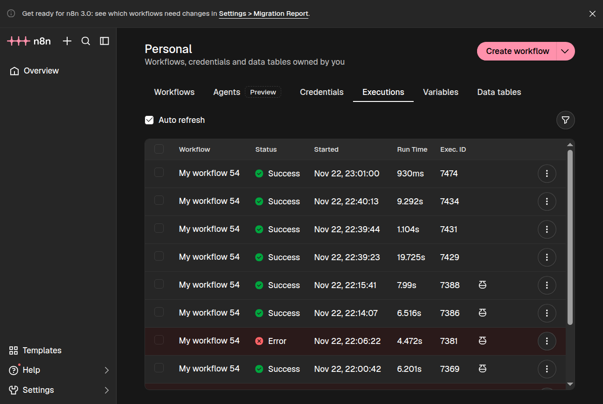
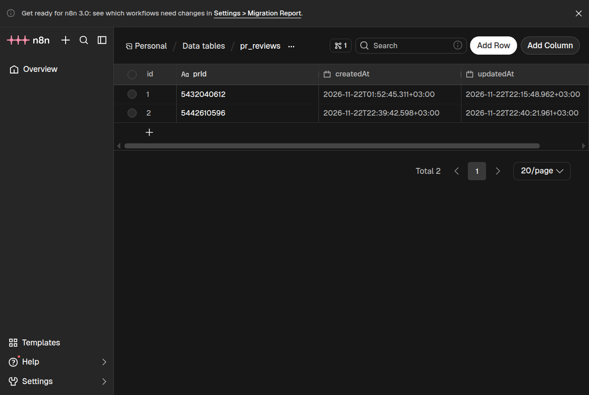
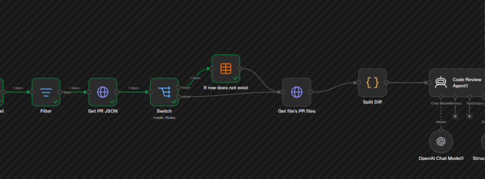
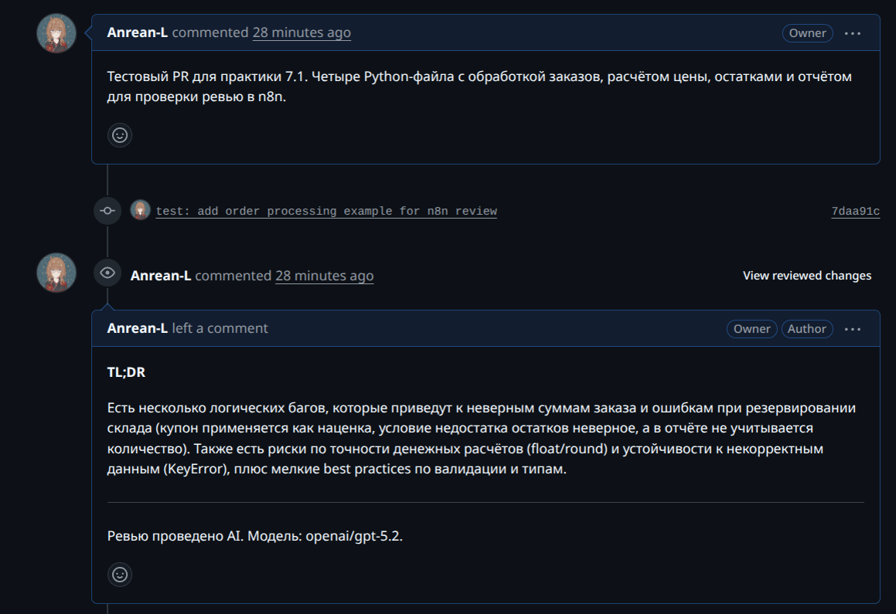
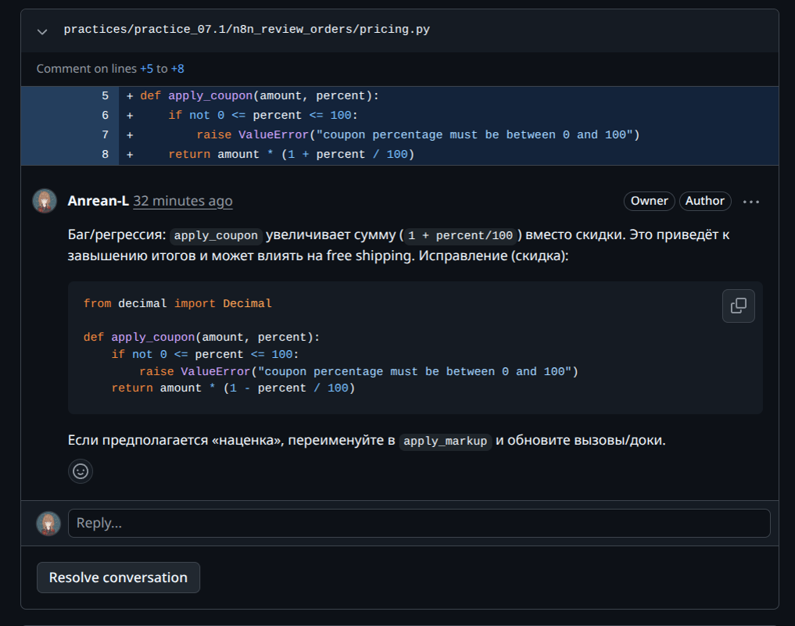
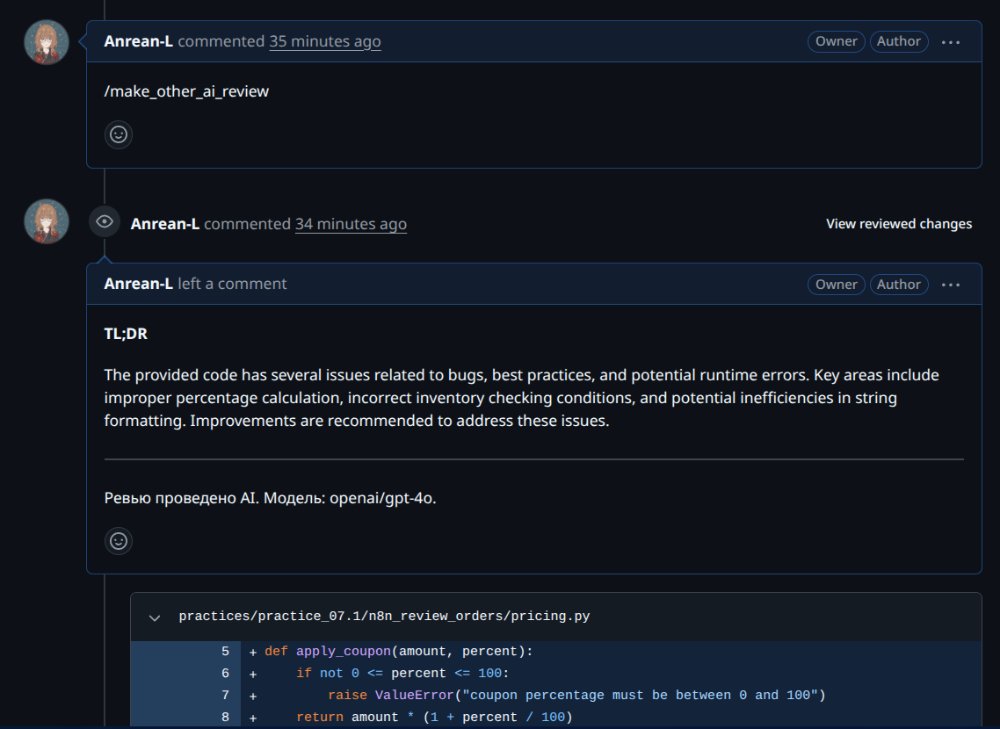

# Практика 7.1: ассистент для код-ревью в n8n

Итоговый workflow: [workflow.json](workflow.json)
Тестовый PR: [test: add order processing example for n8n review](https://github.com/Anrean-L/ITMOv2/pull/8)
Executions:

Data table:

Подтверждение остановки при повторной команде /make_ai_review:

## Полученный результат

При публикации PR сразу запускается ревью более сильной моделью (gpt-5.2). Ревью пишется на проблемные блоки кода, при этом отдельным комментарием выводится TL;DR.

Перменная model выбирается сразу после получения информации о PR. если триггер вызван публикацией PR или командой /make_ai_review, выбирается gpt-5.2, иначе (если была команда /make_ai_review) gpt-4o. при выборе модели просто используется эта переменная

Обе модели - gpt с разницей менее чем в полгода, самое заметное отличие - gpt-4o почему-то пишет на английском. В целях экономии токенов для повторного ревью доступна только модель gpt-4o, а gpt-5.2 вызывается только при публикации или после первой команды /make_ai_review (например, если воркфлоу не был запущен на момент публикации PR). Реализовано с помощью Data table: после ревью в него сохраняется id пулл реквеста, а при запуске ревью на пути gpt-5.5 проверяется, нет ли PR в data table.

## Inline Review

Модель пишет ревью не просто на каждый блок диффа, она указывает в выводе конкретные строки кода, к которым замечание относится. Для этого входной дифф разбивается по файлам, в них добавляются номера строк. Чтобы учесть разный сдвиг строк в старом и новом файлах скрипт идет по диффу двумя указателями. Агент получает дифф с размеченными строками целиком, то есть может найти и те ошибки, которые касаются взаимодействия кода в разных файлах.
