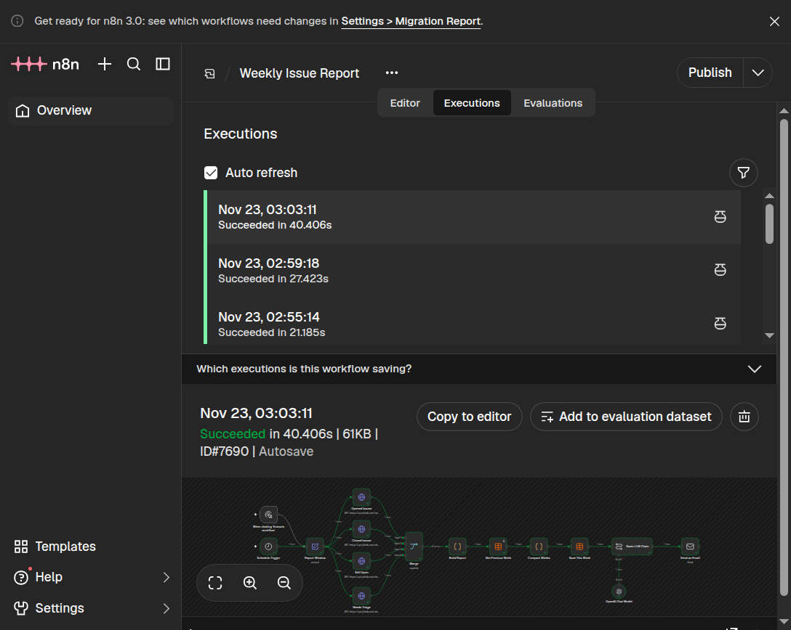
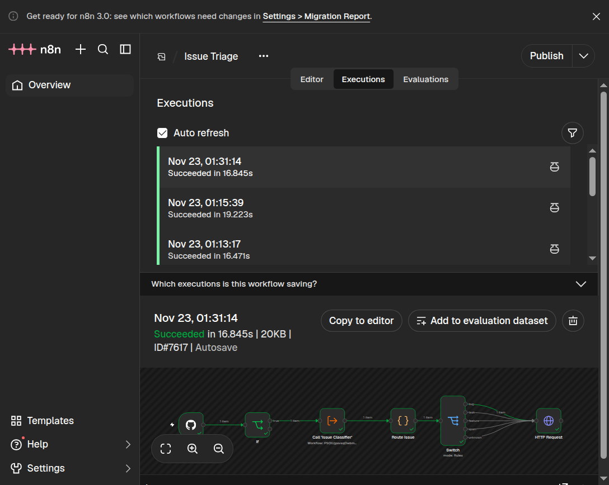
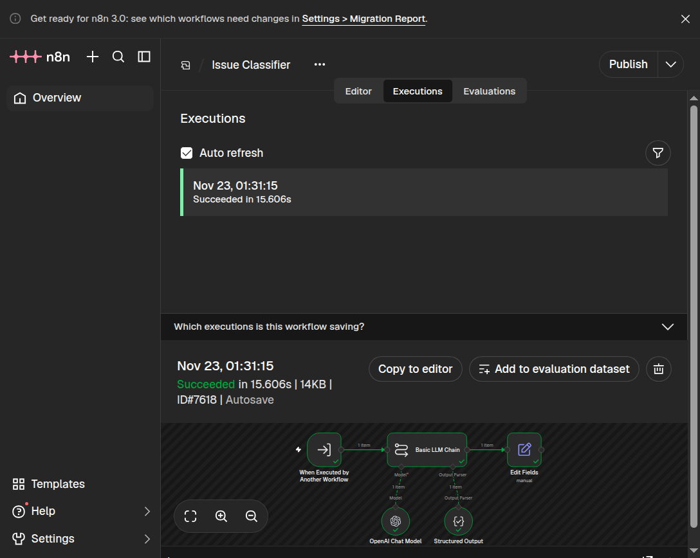
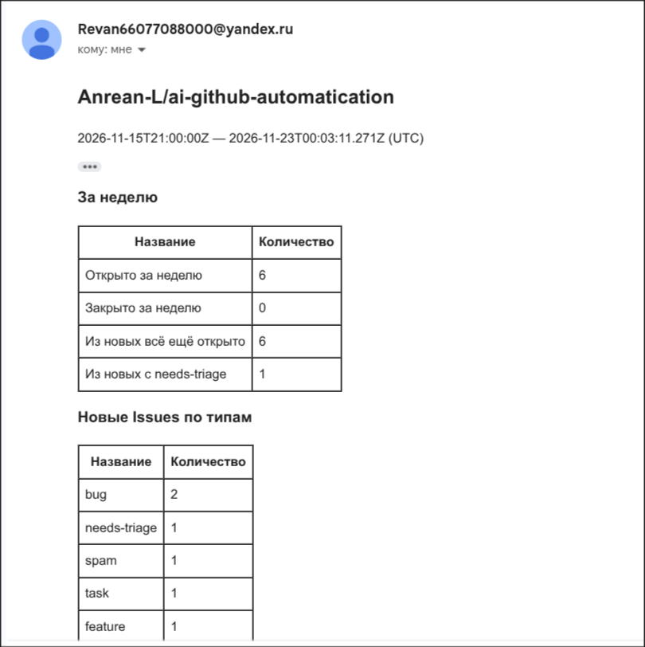
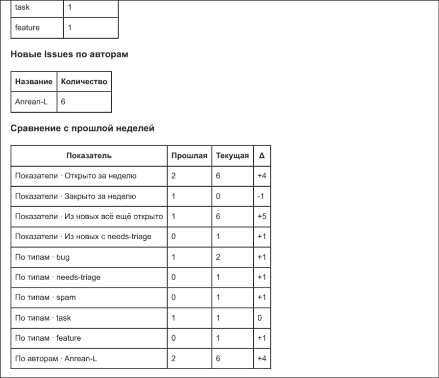
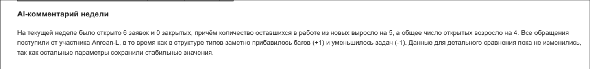

# Практика 7.2: поддержка пользователя с помощью AI-инструментов

Тестовый репозиторий: [Anrean-L/ai-github-automation](https://github.com/Anrean-L/ai-github-automatication)

Executions:

Письмо:

## Работа с Issues

Issue Classifier имеет в качестве триггера запуск другим workflow, являясь sub-workflow Issue Triage. Я передаю туда данные Issue, Classifier возвращает тип и уверенность в нем. Внутри он использует qwen-3.7-flash для установления этих параметров. В промпте я указываю на возможную небезопасность текста ишью. Также в нем содержатся пояснения, что значит каждый лейбл. Все установленные лейблы проходят через switch. Сейчас это не обязательно с точки зрения логики, но помогает по состоянию воркфлоу увидеть, какой путь был выбран, а также в будущем добавить различную логику для разных ишью. Например, назначать разных разработчиков на решение, или пробовать исправить баг агентом.

## Проверка

Я создал тестовый репозиторий, и попросил агента создать несколько PR, которым следует поставить разные метки, в том числе needs triage. Во всех случаях Classifier верно определял тип issue. При этом высокая, но не полная уверенность была достижима (агент не всегда выдавал confidence 1).

## Weekly Report

Для отчета собираются ишью за неделю таких категорий: открытые, закрытые, открытые, но не закрытые, имеющие лейбл needs triage. Полученные ишью отдельно классифицируются по типам (bug, feature...) и авторам. Подготовленные данные загружаются в data table. По данным из этой же data table с прошлой недели мы находим разницу, а агент получает эти данные и делает сводку. Используется модель Qwen-3.7-Flash. Для ручной проверки подключен ручной триггер, но есть и запланированная отправка по понедельникам в 9:00 МСК. 
