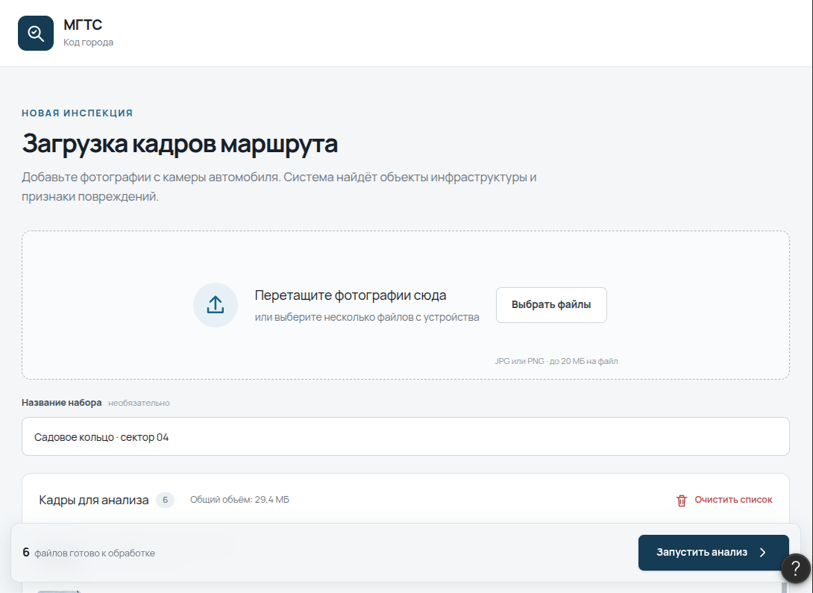
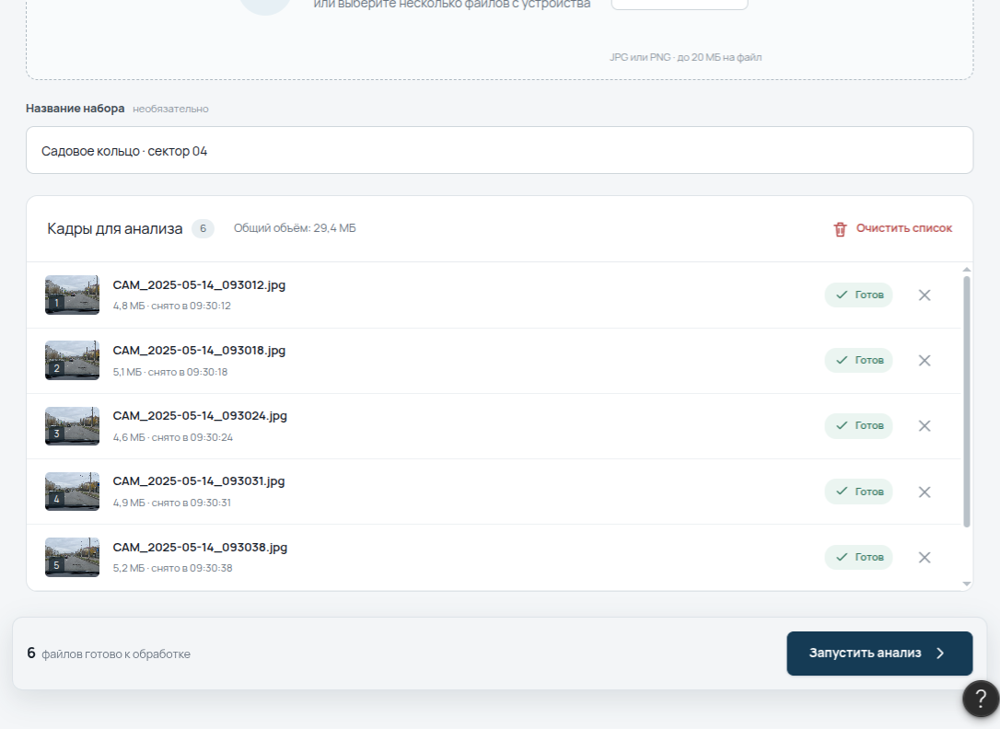
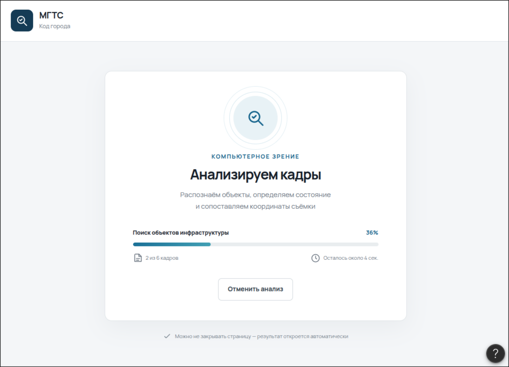
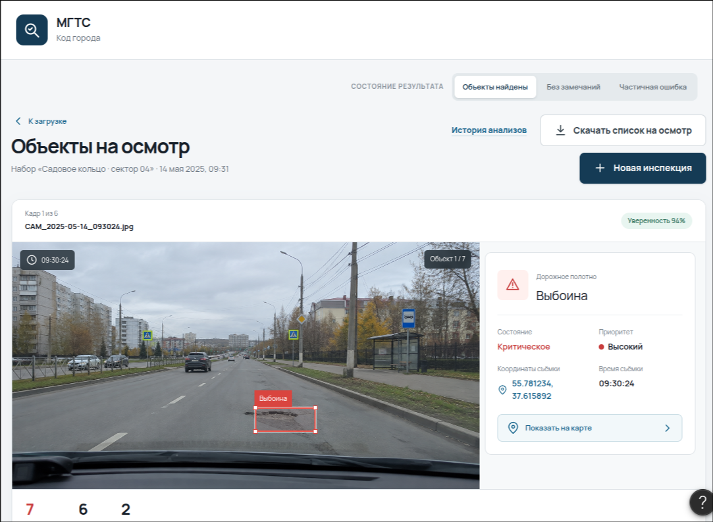
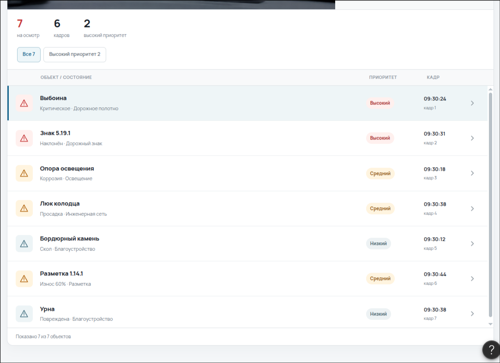
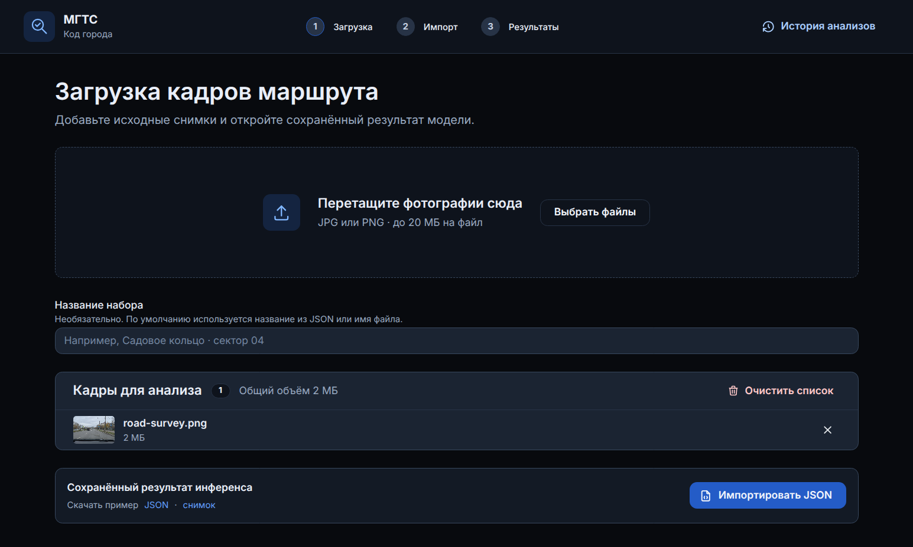
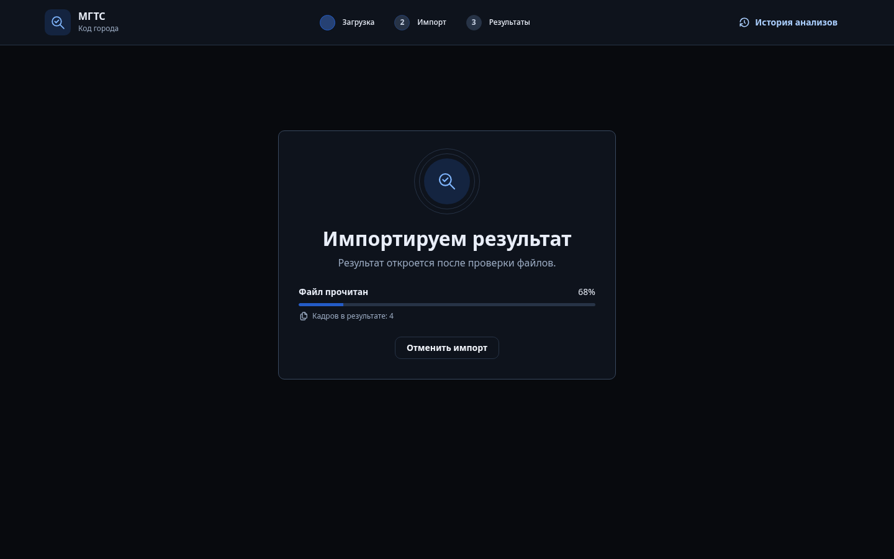
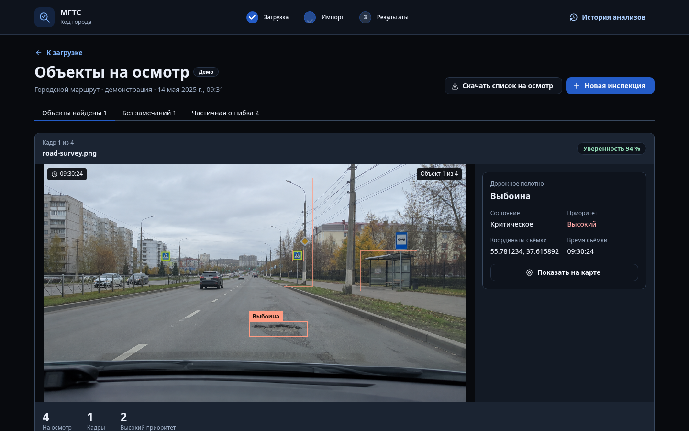
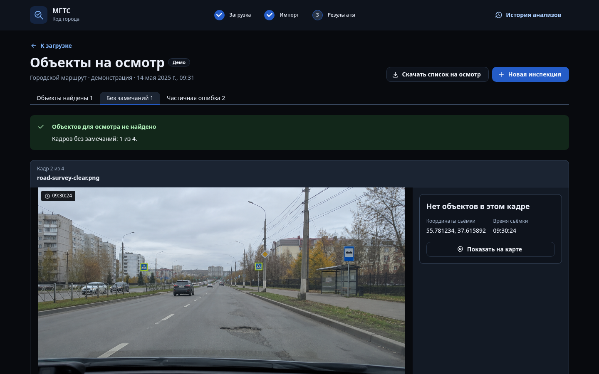
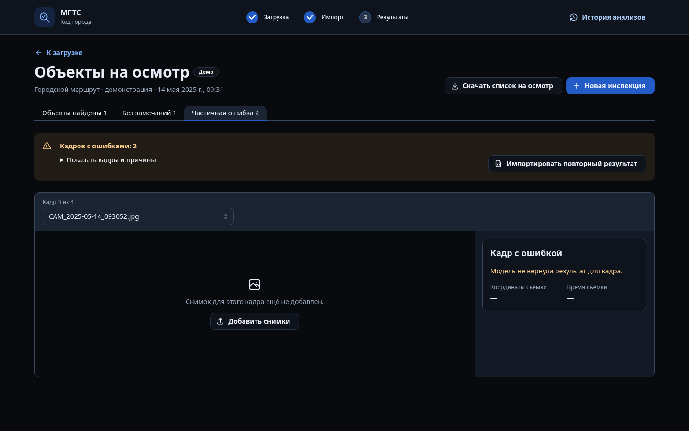

# Фронтенд сервиса мониторинга телекоммуникационной инфраструктуры

Фронтенд нужен для взаимодействия с моделью, которая по загруженному набору фотографий выделяет и классифицирует объекты на них.

## Сценарий

Пользователь (сотрудник МГТС) загружает набор изображений с машины. Фронтенд принимает их, отправляет бэкенду, получает определенные моделью объекты и показывает их пользователю.

## Макет

[Ссылка](https://www.figma.com/make/nTKrzqkIrkneg3QeUE7oJr/%D0%94%D0%B8%D1%81%D0%BF%D0%B5%D1%82%D1%87%D0%B5%D1%80-%D0%BE%D1%81%D0%BC%D0%BE%D1%82%D1%80%D0%B0-%D0%B8%D0%BD%D1%84%D1%80%D0%B0%D1%81%D1%82%D1%80%D1%83%D0%BA%D1%82%D1%83%D1%80%D1%8B?t=lbi3YoQ6I9Lyaxe2-1)

Изначально я описал, какие экраны нужны, какие сценарии надо поддерживать. Агент в Figma Make выдал неплохой интерфейс, но он содержал ненужные нам профиль пользователя и маршрут машины. Я попросил убрать их и добавить историю исследований. Также немного переупорядочили элементы: перенесли фильтр на экран после анализа, вынесли изображение перед списком объектов.

## Разработка

Я выбрал дизайн-систему Mantine. попросил кодекс использовать ее, React+TS, добавил макет. он написал сайт, правда оставались расхождения с макетом. пришлось править. Изначальный результат уже хорошо подходил для мобильных телефонов.

## Тесты

Написали e2e тесты проверяющий основной пользовательский сценарий, в ходе их разработки обеспечили пользователю возможнсть пройти этот сценарий только клавиатурой. Тесты компонентов так же добавили. Для тестов использовался playwrite.

## Конечный результат

### Скриншоты проверки приложения

